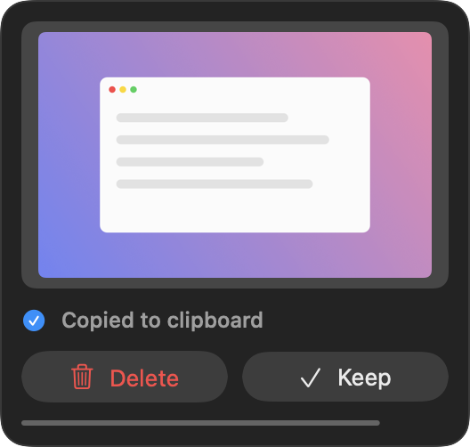

# Screenshotty

A tiny macOS menu bar app. Every time you take a screenshot (⌘⇧4, ⌘⇧3, ⌘⇧5), it copies the image to your clipboard and shows a small card asking whether to delete the file or keep it.



## What it does

- **Copies automatically.** The screenshot is on your clipboard as soon as it is saved, ready to paste.
- **Delete** moves the file to the Trash. The image stays on your clipboard, so you can still paste it.
- **Keep**, or ignoring the card, leaves the file where it is. The card goes away after 6 seconds; hovering over it pauses the countdown.
- **Follows your screenshot folder.** It watches wherever macOS saves screenshots (the Desktop by default) and switches if you change that in the Screenshot app's Options menu.
- **Stays out of the way.** No Dock icon, and the card never takes keyboard focus from the app you are in.

## Install

Requires macOS 14 or later and the Xcode Command Line Tools (`xcode-select --install`). Full Xcode is not needed.

```sh
git clone https://github.com/lakshay007/Screenshotty.git
cd Screenshotty
./build.sh install
```

This builds the app, copies it to `/Applications/Screenshotty.app`, and launches it. On first launch it:

- adds itself to your login items, so it starts when you log in (toggle this from the menu bar icon);
- asks for access to your Desktop folder, which it needs to see new screenshots.

`./build.sh` on its own builds `build/Screenshotty.app` without installing.

## Good to know

- **Turn off the floating thumbnail.** With macOS's own preview thumbnail on, the system waits about 5 seconds before saving the file, so the copy and the card are delayed by the same amount. Turn it off with ⌘⇧5 → Options → Show Floating Thumbnail.
- **Access prompt after rebuilding.** The app is signed ad hoc, so macOS treats each new build as a new app and may ask for Desktop access again.
- **Only real screenshots trigger it.** It looks for the marker macOS puts on screenshot files, so other images saved to the same folder are ignored, as are old screenshots moved back into it.
- **Screen recordings are ignored.**

## Menu bar

The viewfinder icon shows which folder is being watched, a **Launch at Login** toggle, and **Quit**. If the app can't read the screenshot folder, the menu says so and links to the right page in System Settings.

## Troubleshooting

Watch what the app is doing:

```sh
/usr/bin/log stream --info --predicate 'subsystem == "local.screenshotty"'
```

## Uninstall

Turn off **Launch at Login** from the menu bar icon, quit the app, then delete `/Applications/Screenshotty.app`.

## How it works

Under 500 lines of Swift, no dependencies:

| File | Role |
| --- | --- |
| `Sources/ScreenshotWatcher.swift` | Watches the screenshot folder and picks out new screenshot files |
| `Sources/Screenshot.swift` | Loads a screenshot, copies it to the clipboard, moves it to the Trash |
| `Sources/PreviewPanel.swift` | The floating card (SwiftUI inside a non-activating panel) |
| `Sources/AppDelegate.swift` | Menu bar item and launch at login |
| `build.sh` | Compiles with `swiftc`, assembles the `.app` bundle, signs it |

## License

[MIT](LICENSE)
